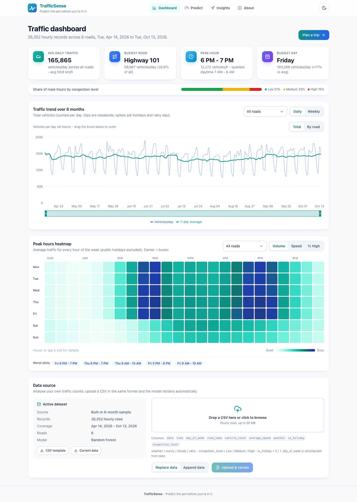
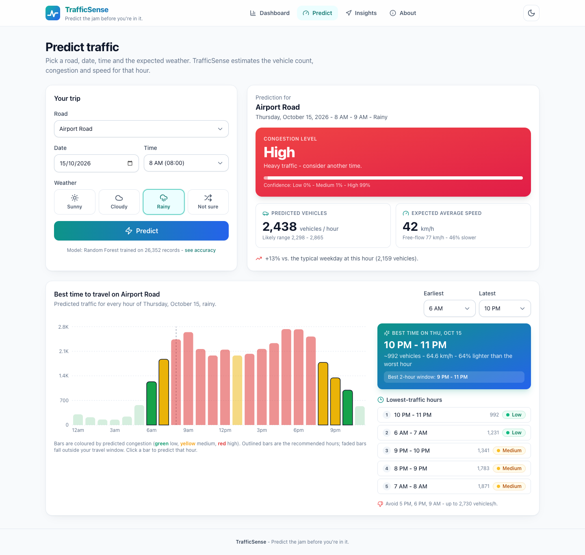
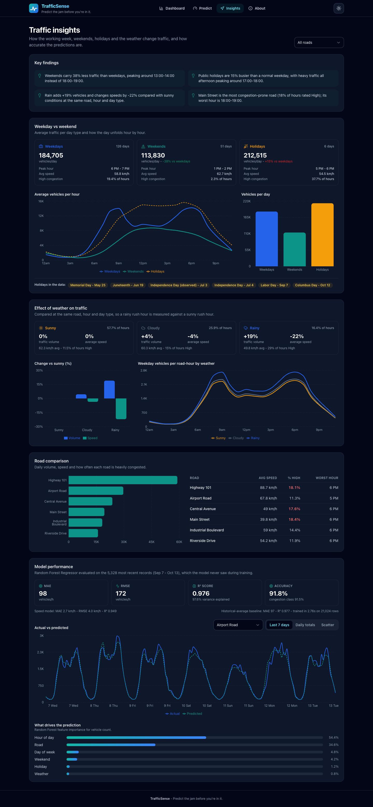
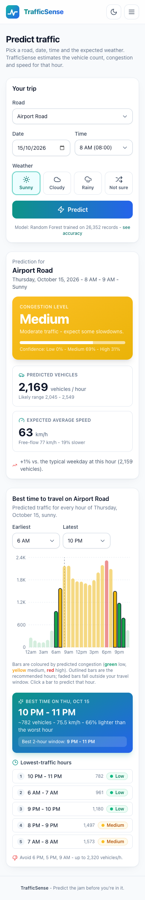

# TrafficSense

**Predict the jam before you're in it.**

TrafficSense is a full-stack traffic prediction app. It analyses the last 6 months of hourly traffic data and predicts
future conditions, so you can see traffic levels ahead of time and pick the best time to travel.

## Live demo

| | URL |
| --- | --- |
| **Web app** (GitHub Pages) | `https://<your-github-username>.github.io/trafficsense/` |
| **Web app** (Vercel) | `https://<your-vercel-project>.vercel.app/` |
| **API** (Render free tier) | `https://trafficsense-api.onrender.com` (yours may have a suffix; see [Deploy](#deploy-online-github-pages--render)) |
| **API docs** (Swagger) | `https://trafficsense-api.onrender.com/docs` |

> Replace the placeholders with your links after deploying. The free Render server **sleeps after 15 minutes idle**.
> The first visit afterwards shows *"Waking up the server, this can take up to a minute..."* and retries automatically.
> If the server can't be reached at all, the app switches to **offline mode** and serves precomputed data.

| Dashboard | Predict + best time to travel |
| --- | --- |
|  |  |
| **Insights + model performance (dark mode)** | **Mobile** |
|  |  |

---

## Architecture

```
        Browser
           |
           |  https://<user>.github.io/trafficsense/      (static React build)
           v
 +-----------------------+      fetch (CORS)       +--------------------------------+
 |  GitHub Pages         | ----------------------> |  Render free web service       |
 |  frontend/dist        |   VITE_API_URL          |  FastAPI + uvicorn ($PORT)     |
 |  + data/*.json        | <---------------------- |  pandas, scikit-learn, SQLite  |
 |  (offline fallback)   |        JSON             |  RF trained on every start     |
 +-----------------------+                         +--------------------------------+
           ^                                                      ^
           | GitHub Actions (.github/workflows/deploy.yml)        | Render Blueprint (render.yaml)
           | on push to main: export offline JSON -> vite build   | on push to main: pip install
           +----------------------------- GitHub repo ------------+
```

- **Frontend: GitHub Pages and/or Vercel.** The same static Vite build is hosted in two places:
  - **GitHub Pages** serves it under `/trafficsense/`. Deep links use `public/404.html`.
  - **Vercel** serves it from `/`. Deep links use the rewrite in `frontend/vercel.json`.

  The backend URL is baked in at build time from `VITE_API_URL`, and the base path comes from `VITE_BASE_PATH`.
- **Backend: Render.** On every start it generates the 6-month sample, loads it into SQLite, and trains the Random Forests (≈6–15 s). CORS allows localhost, any `https://*.github.io` site, and every origin listed in `ALLOWED_ORIGINS` (for example your Vercel domain).
- **Cold starts.** Read-only views show saved data after ~8 s while the server wakes, then refresh with live data once it answers. Predictions and uploads always wait for the live server.
- **Offline fallback.** `frontend/public/data/` holds precomputed JSON exported by `backend/scripts/export_static.py`. These files are **committed to git**, so Vercel serves them without running Python. The GitHub Pages workflow regenerates them on each deploy. They contain:
  - summary, trends, heatmaps and insights (each for all roads and per road)
  - model metrics
  - a prediction table covering every road × hour × day × weather × holiday combination (6,048 predictions)

  If the API can't be reached for ~75 s, the app serves these files with an **Offline mode** badge, keeps re-checking every 15 s, and switches back to live data automatically.

## Features

| # | Feature | Where |
| --- | --- | --- |
| 1 | **Dashboard**: summary cards (average daily traffic, busiest road, peak hour, busiest day), congestion share bar, and a 6-month trend line chart (daily with a 7-day average, or weekly; total or per road; brush to zoom) | `/` |
| 2 | **Prediction**: choose a road, date, time and weather (or "Not sure"), then press **Predict**. Shows the predicted vehicle count with a likely range, the congestion level (green / yellow / red, with class probabilities), the expected average speed versus free flow, and a comparison with the typical hour | `/predict` |
| 3 | **Best time to travel**: predicted traffic for all 24 hours of the chosen road and date. Highlights the lowest-traffic hours inside your travel window plus the best 2-hour block. Click a bar to predict that hour | `/predict` |
| 4 | **Peak-hours heatmap**: hour of day × day of week, by volume, speed or % of hours rated High, for all roads or one road | `/` |
| 5 | **Insights**: weekday vs weekend vs holiday comparison (cards, hourly profiles, bar chart), the effect of weather on volume and speed, a road comparison, and auto-generated key findings | `/insights` |
| 6 | **Model performance**: MAE, RMSE, R² and accuracy on a held-out period. Actual vs predicted charts (last 7 days hourly per road, daily totals, scatter), feature importance, and a comparison with the statistical baseline | `/insights#model` |
| + | **Bring your own CSV**: upload in the same format (replace or append). Rows are validated, stored in SQLite, and the model retrains immediately. You can also download a template, download the current data, or restore the sample | Dashboard → *Data source* |
| + | **Cold-start & offline handling**: a waking-server banner with automatic retries, and an offline mode built from precomputed JSON | everywhere |
| + | Light and dark mode (follows the system setting, toggle saved), responsive layout, mobile navigation menu, loading/empty/error states | everywhere |

> **Uploaded data is temporary on the free hosted server.** Render's free disk is ephemeral and the service restarts when it sleeps, redeploys or is restarted. Every restart regenerates the bundled 6-month sample and retrains on it, so an uploaded CSV lasts only until the next restart. Re-upload it after the server wakes. Offline mode always shows the bundled sample, and uploads need the live server.

## Tech stack

**Frontend:** React 18, React Router 6, Tailwind CSS 3 (class-based dark mode, blue/teal theme), Recharts 2 (line, bar and scatter charts), lucide-react icons, Vite 5. The heatmap is a responsive CSS grid. Hosted on GitHub Pages and deployed by GitHub Actions.

**Backend:** Python 3.11, FastAPI and Uvicorn, Pandas and NumPy, scikit-learn (`RandomForestRegressor` / `RandomForestClassifier`), joblib, and SQLite (stdlib `sqlite3`). Hosted on the Render free tier through a Blueprint (`render.yaml`).

## Folder structure

```
trafficsense/
├── README.md
├── render.yaml                 # Render Blueprint (backend web service, free plan)
├── .github/workflows/deploy.yml  # build frontend + deploy to GitHub Pages
├── backend/
│   ├── requirements.txt        # pinned runtime deps (what Render installs)
│   ├── requirements-dev.txt    # + pytest / httpx
│   ├── .python-version         # 3.11
│   ├── .env.example
│   ├── app/
│   │   ├── main.py            # FastAPI app + all /api routes, CORS
│   │   ├── config.py          # paths, CORS origins, env-var settings
│   │   ├── data_generator.py  # realistic 6-month hourly sample dataset
│   │   ├── holidays.py        # computed public-holiday calendar
│   │   ├── database.py        # SQLite schema, load/replace/read
│   │   ├── dataset.py         # CSV validation/cleaning + derived features
│   │   ├── model.py           # Random Forest + statistical fallback, metrics, joblib bundle
│   │   ├── service.py         # analytics (summary, trends, heatmap, insights, best time, predict)
│   │   └── schemas.py         # request models
│   ├── scripts/export_static.py  # writes the offline JSON into frontend/public/data/
│   ├── data/   models/        # created at runtime (git-ignored)
│   └── tests/test_api.py      # end-to-end API tests
├── frontend/
│   ├── package.json  vite.config.js  tailwind.config.js  postcss.config.js  index.html  .env.example
│   ├── vercel.json            # Vercel build settings + SPA rewrite (deep links -> index.html)
│   ├── public/
│   │   ├── 404.html           # GitHub Pages deep-link (SPA) fallback
│   │   └── data/*.json        # offline-mode data (committed; used as-is by Vercel, regenerated by the Pages workflow)
│   └── src/
│       ├── api.js             # API client: VITE_API_URL, wake-up retries, offline fallback
│       ├── lib/               # AppContext, offline.js (prediction table lookup), hooks, formatters
│       ├── components/        # Navbar, ConnectionStatus, TrendChart, Heatmap, BestTime, ModelPerformance, DataUpload, ui
│       └── pages/             # Dashboard, Predict, Insights, About
└── docs/screenshots/
```

## The dataset

On every start the backend generates `backend/data/traffic_data.csv` and loads it into SQLite (`backend/data/trafficsense.db`). If a sample less than 7 days old already exists, it is reused.
The sample covers the **last 6 months up to yesterday** with one record per road per hour: about 183 days × 24 h × 6 roads = **~26,350 rows**.

| Column | Example | Notes |
| --- | --- | --- |
| `date` | `2026-10-13` | `YYYY-MM-DD` |
| `time` | `08:00` | hourly |
| `day_of_week` | `Tuesday` | |
| `road_name` | `Highway 101` | Highway 101, Central Avenue, Main Street, Riverside Drive, Airport Road, Industrial Boulevard |
| `vehicle_count` | `5530` | vehicles in that hour |
| `average_speed` | `44.0` | km/h |
| `weather` | `rainy` | `sunny` / `cloudy` / `rainy` |
| `is_holiday` | `0` | `0` / `1` |
| `congestion_level` | `High` | `Low` / `Medium` / `High` |

**Patterns built into the sample:**

- **Weekday commute peaks** at 8–10 AM and 5–8 PM, with very quiet nights. Each road has its own profile.
- **Weekends are about 38% lighter**, with a broad early-afternoon hump instead of rush hours. Friday is the busiest day.
- **Holidays are about 15% heavier** than a normal weekday. Holidays come from a computed US federal calendar.
- **Rain**: about 19% more vehicles, about 22% lower speeds, and less road capacity, so the same volume becomes more congested.
- Congestion follows a speed-flow curve. It is labelled from volume/capacity and the speed ratio.
- Also included: mild seasonality, a slow growth trend, daily and hourly noise, and rare incidents.

**Uploading your own CSV:** use the same columns (header names are case-insensitive). The validator:

- accepts flexible time formats (`8`, `08:00`, `8:30 PM`) and common synonyms
- recomputes `day_of_week` from the date
- drops duplicate rows
- rejects invalid rows individually with a per-reason report

At least 100 valid rows are required. *Replace* swaps the dataset; *Append* merges it in.

## How the prediction works

1. **Features.** Each hourly record becomes `hour`, `day_index` (Mon=0), `is_weekend`, `is_holiday`, `road_name` and `weather`. Road and weather are one-hot encoded inside a scikit-learn `Pipeline`.
2. **Models.** Three Random Forests:
   - `RandomForestRegressor` → **vehicle_count**
   - `RandomForestRegressor` → **average_speed**
   - `RandomForestClassifier` → **congestion_level**, giving Low/Medium/High probabilities
3. **Training on startup.** The models are trained on every start and saved to `backend/models/traffic_model.joblib`. They also retrain after each upload or reset.
4. **Sized for 512 MB.** The forests use **40 trees** with at most **2,000 leaves** per tree. The original 120 unlimited trees gave identical accuracy at about 4× the size:

   | Configuration | Test R² | MAE | RMSE | Pickled size | Peak RAM at startup |
   | --- | --- | --- | --- | --- | --- |
   | 120 trees, unlimited leaves (before) | 0.9762 | 98.3 | 171.9 | 129 MB | ≈ 455–570 MB |
   | **40 trees, ≤ 2,000 leaves (now)** | **0.9761** | **98.7** | **172.4** | **32 MB** | **≈ 270–340 MB** |

   The peak RAM figures are measured locally. Tune with `TRAFFICSENSE_RF_TREES` and `TRAFFICSENSE_RF_MAX_LEAF_NODES`.
5. **Honest evaluation.** The models are scored on a chronological 80/20 split: trained on the first 80% of days, tested on the most recent 20%. They are then refit on all data.
6. **Statistical fallback.** If scikit-learn is unavailable, training fails, or `TRAFFICSENSE_FORCE_STATISTICAL=1` is set, predictions come from historical averages for the same *road + weekday + hour + weather*. Rare combinations back off to broader groups.
7. **Offline predictions.** `export_static.py` evaluates the trained models on all 6,048 combinations of road × day of week × hour × weather × holiday flag. Offline, the frontend looks the answer up in that table:
   - future holidays are detected with the same holiday calendar
   - "Not sure" weather uses the same month-weighted blend

   As a result, offline predictions match the live API exactly for the sample dataset.

> On the bundled synthetic data the historical-average baseline scores almost the same as the forest. With real, messier data the Random Forest usually pulls ahead.

## API endpoints

Base URL: `http://localhost:8000` locally, or your Render URL online. Interactive docs are at `/docs`.

| Method | Path | Purpose |
| --- | --- | --- |
| GET | `/api/summary` | Dashboard stats: avg daily traffic, busiest road, peak hour, busiest day, congestion share, road ranking |
| GET | `/api/trends?granularity=daily\|weekly&road=` | Daily or weekly trend points, per-road split, monthly averages |
| POST | `/api/predict` | Body `{ "road", "date", "time", "weather", "is_holiday"? }` → vehicle count (+ range), congestion level (+ probabilities), avg speed |
| GET | `/api/best-time?road=&date=&weather=auto&start_hour=0&end_hour=23&top=5` | 24-hour predicted profile, lowest-traffic hours, best 2-hour block |
| GET | `/api/heatmap?road=&metric=vehicle_count\|average_speed\|high_congestion` | 7×24 hour-of-day vs day-of-week grid |
| GET | `/api/model-metrics` | MAE, RMSE, R², accuracy, baseline, split, feature importance, actual-vs-predicted |
| POST | `/api/upload` | Multipart `file` (CSV) + `mode=replace\|append` → validate, store, retrain |
| GET | `/api/insights?road=` | Weekday/weekend/holiday, weather effect, road comparison, findings |
| GET | `/api/meta` · `/api/health` · `/` | Form metadata · health check (used by Render) · API info |
| POST | `/api/reset` | Restore the bundled sample and retrain |
| GET | `/api/sample-csv` · `/api/dataset.csv` | CSV template · active dataset |

```bash
curl -X POST https://trafficsense-api.onrender.com/api/predict \
  -H "Content-Type: application/json" \
  -d '{"road": "Highway 101", "date": "2026-10-20", "time": "08:00", "weather": "rainy"}'
```

---

## Run it locally

**Prerequisites:** Python **3.11+** and Node.js **18+** (20 LTS recommended).

### 1. Backend

```bash
cd backend
python3 -m venv venv
source venv/bin/activate              # Windows: venv\Scripts\activate
pip install -r requirements-dev.txt   # runtime deps + pytest
uvicorn app.main:app --reload --port 8000
```

Startup takes about 5–10 s, which covers generating the data and training the model. It is done when the log shows `TrafficSense ready: 26352 rows ... model=random_forest`. The API docs are at http://localhost:8000/docs.

### 2. Frontend (dev server)

```bash
cd frontend
npm install
npm run dev            # http://localhost:5173  (calls http://localhost:8000 by default)
```

### 3. Production build locally

```bash
cd frontend
# GitHub Pages flavour (base /trafficsense/)
VITE_API_URL=http://localhost:8000 npm run build
npm run preview                                       # http://localhost:4173/trafficsense/

# Vercel flavour (base /)
VITE_API_URL=http://localhost:8000 VITE_BASE_PATH=/ npm run build
npm run preview                                       # http://localhost:4173/
```

Stop the backend and reload the page to see the waking banner and then **offline mode**.

### 4. Regenerate the offline data

```bash
cd backend && python -m scripts.export_static    # writes ../frontend/public/data/*.json
```

Commit the result if you changed the model, data generator or analytics. Vercel uses the committed files.

### 5. Tests

```bash
cd backend && pytest -q        # 15 tests: 11 end-to-end API tests + 4 CORS tests
```

### Configuration

**Backend** (environment variables):

| Variable | Default | Effect |
| --- | --- | --- |
| `ALLOWED_ORIGINS` | – | Extra allowed CORS origins, comma-separated. Example: `https://trafficsense.vercel.app,https://trafficsense-*.vercel.app` (`*` matches one host label, which covers Vercel preview URLs) |
| `GITHUB_PAGES_ORIGIN` | – | Extra allowed CORS origin, e.g. `https://octocat.github.io` |
| `TRAFFICSENSE_CORS_ORIGINS` | localhost list | Replace the localhost defaults (comma-separated) |
| `TRAFFICSENSE_CORS_ORIGIN_REGEX` | `*.github.io` + localhost | Extra regex of allowed origins; set to empty to disable |
| `TRAFFICSENSE_RF_TREES` / `TRAFFICSENSE_RF_MAX_LEAF_NODES` | `40` / `2000` | Forest size (memory vs accuracy) |
| `TRAFFICSENSE_RF_N_JOBS` | `1` on Render, else `-1` | Parallel fitting |
| `TRAFFICSENSE_FORCE_STATISTICAL` | `0` | Use the historical-average model |
| `TRAFFICSENSE_SERVE_FRONTEND` | `0` | Also serve `frontend/dist` from FastAPI. Build it with `VITE_BASE_PATH=/` |

**Frontend** (build-time; `frontend/.env.local`, the GitHub workflow, or Vercel project settings):

| Variable | Default | Effect |
| --- | --- | --- |
| `VITE_API_URL` | `http://localhost:8000` | Backend base URL |
| `VITE_BASE_PATH` | builds: `/` on Vercel, `/trafficsense/` elsewhere; dev: `/` | Public base path. `VITE_BASE` is still accepted as an alias |
| `VITE_OFFLINE_ONLY` | `0` | `1` = never call the API and always use the offline JSON |

---

## Deploy online (GitHub Pages + Render)

### 1. Push the code to GitHub

1. On https://github.com/new, create a repository named **`trafficsense`**:
   - Public visibility is required for GitHub Pages on a free account.
   - Do **not** add a README, .gitignore or license.
2. In this folder:

   ```bash
   git remote add origin https://github.com/<your-github-username>/trafficsense.git
   git push -u origin main
   ```

   For the password prompt, use a personal access token from GitHub → Settings → Developer settings → Personal access tokens → *Fine-grained*, with *Contents: Read and write* on this repo. Alternatively, use `git@github.com:...` with an SSH key.

### 2. Deploy the backend on Render

1. Sign in at https://dashboard.render.com with GitHub.
2. Click **New → Blueprint**, connect the `trafficsense` repo, and select it. Render finds `render.yaml`.
3. When prompted for **`GITHUB_PAGES_ORIGIN`**, enter `https://<your-github-username>.github.io`, with no trailing slash or path.
4. Click **Deploy Blueprint**. The build takes a few minutes. The deploy is finished when the log shows `TrafficSense ready` and `/api/health` passes.
5. Copy the service URL shown at the top of the service page, e.g. `https://trafficsense-api.onrender.com`. Render may add a suffix if the name is taken. Check it at `<url>/api/health`.

### 3. Point the frontend at Render and enable GitHub Pages

1. **Set the backend URL.** Use either method:
   - **Recommended:** add a repository variable. Go to Settings → Secrets and variables → Actions → **Variables** → *New repository variable* and set Name `VITE_API_URL`, Value = your Render URL.
   - **Or** edit `RENDER_API_URL` in `.github/workflows/deploy.yml`, then commit and push.
2. Turn on Pages: Settings → **Pages** → Build and deployment → **Source: GitHub Actions**.
3. Go to the **Actions** tab → *Deploy frontend to GitHub Pages* → **Run workflow**, or push any commit. When it is green, the site is live at `https://<your-github-username>.github.io/trafficsense/`.
4. Put your two URLs in the **Live demo** table at the top of this README.

**Updating later:** `git push` to `main` redeploys both. Render redeploys the backend and the workflow rebuilds the site, including regenerating the offline JSON.

### 4. (Optional) Also host the frontend on Vercel

The backend stays on Render. Vercel builds only the `frontend/` folder and needs no Python, because the offline JSON is committed.

1. At https://vercel.com/new, click **Import Git Repository**, choose `trafficsense`, and use these settings:

   | Setting | Value |
   | --- | --- |
   | Framework Preset | **Vite** |
   | Root Directory | **`frontend`** |
   | Install Command | `npm ci` |
   | Build Command | `npm run build` |
   | Output Directory | `dist` |

   `frontend/vercel.json` already sets the last three, so Vercel fills them in automatically.

2. Under **Environment Variables**, add these for Production and Preview:
   - `VITE_API_URL` = your Render URL, e.g. `https://trafficsense-api.onrender.com`
   - `VITE_BASE_PATH` = `/`. This is optional: Vercel builds default to `/`, but setting it makes the choice explicit.
3. Click **Deploy**. Note the production domain, e.g. `https://trafficsense.vercel.app`.
4. In Render, open the service → **Environment**, add `ALLOWED_ORIGINS` = `https://trafficsense.vercel.app,https://trafficsense-*.vercel.app`, and save.
   - Use your real domain, with no trailing slash.
   - The `*` entry covers preview deployments.
   - Saving restarts the service.
5. Open the Vercel URL and check two things:
   - A direct link like `https://trafficsense.vercel.app/predict` loads the Predict page.
   - The Network tab shows `/api/...` calls to Render returning 200 with no CORS errors.

After this, every push to `main` redeploys Render, GitHub Pages and Vercel. Vercel also creates a preview URL for every branch and PR.

---

*The bundled data is synthetic and for demonstration only. Upload real counts to get real-world predictions.*
